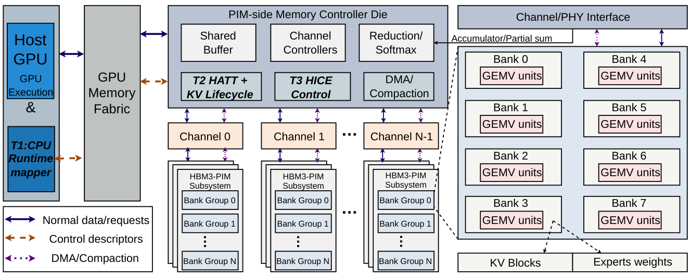
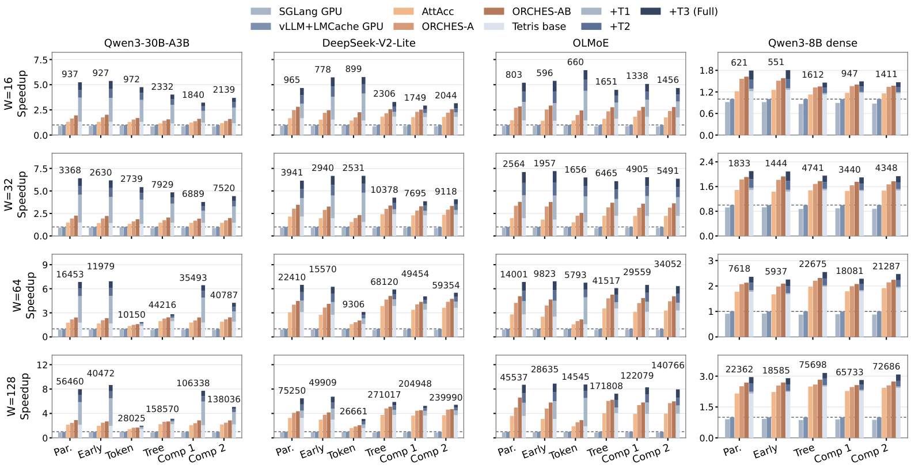

# Tetris

**Accelerating Composable Test-Time Scaling on GPU-PIM Systems via Adaptive Mapping, Control, and Memory Management**

Shengxuan Qiu, Haochen Huang, Tenghao Zhao, and Meng Li · **HPCA 2027**

Tetris is a GPU–PIM architecture for composable test-time scaling. This repository contains its trace-driven simulator, HBM3-PIM extensions for Ramulator2, workload trace inputs, and controller RTL. The simulator replays recorded action boundaries and models adaptive GPU/PIM mapping (T1), local KV lifecycle management (T2), and speculative preparation of controller state (T3).



## Run the simulator

Use Ubuntu or WSL with Python 3.10–3.12, a C++ compiler, CMake, Git, and patch. Run the commands from the repository root.

```bash
sudo apt-get install -y python3-venv build-essential cmake git patch
python3 -m venv .venv
source .venv/bin/activate
python -m pip install -r requirements.txt
bash scripts/build_ramulator.sh
```

The build script fetches the pinned [Ramulator2 revision](https://github.com/CMU-SAFARI/ramulator2/commit/b7c70275f04126c647edb989270cc429776955d1), applies the HBM3-PIM sources and patches, and builds the executable locally. Use `JOBS=4 bash scripts/build_ramulator.sh` to set build parallelism.

```bash
python -m scripts.replay \
  --trace inputs/qwen3_16.json \
  --model model_config/qwen3.json \
  --output runs/qwen3-w16.json
```

This compares AttAcc, ORCHES-A, ORCHES-AB, and Full Tetris on the same trace. ORCHES-A updates placement at branch rounds and ORCHES-AB updates at action boundaries with the same software KV policy. Each scans β over 0.1, 0.3, 0.5, 0.7, and 0.9 and selects the lowest-latency point. The JSON reports latency components, the β scan, and paired speedup over ORCHES-AB. Add `--steps` for a boundary breakdown, `--ablation` for standalone and leave-one-out T1–T3 comparisons, or `--orin-ms <latency>` to normalize to a measured Orin reference for the same workload.

For a quick check, add `--analytical` and use a separate output path. This selects the analytical PIM service model and can run before building Ramulator2. The default selects tiled command replay for PIM attention and caches service times on the local machine.

## Simulator configuration

| Resource | Evaluation configuration |
| --- | --- |
| GPU and interface | Orin-anchored 43/85 TFLOP/s FP16 dense/sparse peak reference. The replay cost model uses a 43 TFLOP/s GPU compute roof and a 204.8 GB/s GPU-facing service budget. |
| HBM organization | Four HBM3 stacks, 16 channels per stack, two pseudochannels per channel, two ranks, four bank groups, and four banks per group. Total capacity is 64 GiB across 4,096 banks. |
| Channel bandwidth | 670.4 GB/s per stack, or 2,681.6 GB/s aggregate channel-side reference bandwidth. |
| Bank-local PIM | 16 MACs per bank, 87.2 TFLOP/s aggregate compute, and a 24.2 TB/s nominal internal operand roof. |
| Command timing | AttAcc/Ramulator2 `HBM3_8Gb_2R` and power-constrained `HBM3_5.2Gbps` presets with all-bank refresh. Nominal tCK, tREFI, and tRFC are 0.769 ns, 3.899 μs, and 350 ns. |
| Precision | INT4 weight-only quantization and FP16 activations. Trace replay holds the recorded actions fixed across policies. |

The modeled GPU and MCD communicate over an on-package front end. GPU loads and exchanged results use its 204.8 GB/s budget. The HBM channel reference describes stack-side service, and bank-local operand reads use near-bank resources. The simulator combines modeled GPU, PIM, transfer, KV, and control costs at action boundaries. The Ramulator2 integration generates bounded PIM command tiles using a 16-channel stack template and scales their service time in the replay model. T1 mapping charges use a 200 MHz operation-count reference. T3 uses a deterministic 0.8 hit-probability setting for timing replay.

## Paper performance



The paper normalizes each group to the faster of measured SGLang and vLLM+LMCache on Orin. Labels above the bars give that reference latency in milliseconds. Against tuned, action-matched ORCHES-AB under common GPU–PIM resources, the paper reports mean paired speedups of **1.87× on MoE** and **1.10× on dense** workloads. The dense panels use separate axes.

## Repository layout

| Path | Contents |
| --- | --- |
| [src/](src/) | Trace replay, latency model, KV lifecycle, and Ramulator2 integration |
| [model_config/](model_config/) | Model dimensions and expert configuration |
| [inputs/](inputs/) | JSON-lines action traces, indicator traces, and expert-routing inputs |
| [pim_ramulator_src/](pim_ramulator_src/) | HBM3-PIM sources, build patches, presets, and command trace generators |
| [scripts/](scripts/) | Backend build and paired replay entry points |
| [rtl/](rtl/) | Controller RTL and behavioral testbench |
| [docs/figures/](docs/figures/) | Architecture and performance illustrations from the paper |

Action traces in `inputs/` contain one event per line, even where the extension is `.json`. Pass the matching model configuration with `--model`. The `indicator/` and `expert-routing/` subdirectories contain source traces for controller and routing analyses.

To run the controller behavioral check and synthesis sanity flow with Vivado on PATH:

```bash
vivado -mode batch -source rtl/vivado_rtl_sanity.tcl
```

Tetris builds on the [AttAcc simulator](https://github.com/scale-snu/attacc_simulator) and [Ramulator2](https://github.com/CMU-SAFARI/ramulator2). See [LICENSE](LICENSE) for the inherited license.

## Citation

```bibtex
@inproceedings{qiu2027tetris,
  title     = {{Tetris}: Accelerating Composable Test-Time Scaling on {GPU-PIM}
               Systems via Adaptive Mapping, Control, and Memory Management},
  author    = {Qiu, Shengxuan and Huang, Haochen and Zhao, Tenghao and Li, Meng},
  booktitle = {IEEE International Symposium on High-Performance Computer Architecture},
  year      = {2027}
}
```
